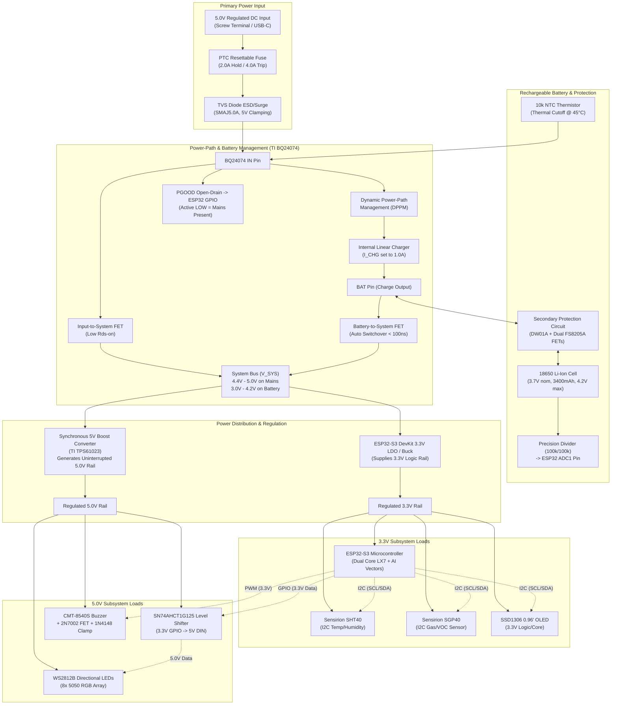

# ExitIQ: Edge AI Emergency Evacuation Guidance Prototype
## Preliminary Engineering Design & Architecture Notes

**Document Version:** 1.0.0  
**Project Date:** October 2026  
**Status:** Preliminary Design Review (Pre-Schematic)  
**Target ECAD Tool:** KiCad 10.0.6  
**Target MCAD Tool:** Dassault Systèmes CATIA V5-6R2022 / Autodesk AutoCAD 2021  

---

## 1. System Overview & Provisional Requirements

ExitIQ is an intelligent, localized Edge AI emergency evacuation guidance terminal. The device actively monitors environmental conditions (ambient temperature, combustion gases/smoke), processes threat vectors locally via an ESP32-S3 microcontroller running edge inference/rules, and dynamically signals safe evacuation routes via directional WS2812B LEDs, an SSD1306 graphic display, and an audible alarm buzzer.

### Provisional Requirements Checklist
1. **Main Edge Controller:** ESP32-S3 development board (Xtensa dual-core with vector instructions for AI acceleration).
2. **Temperature Sensor:** Real-time localized ambient temperature monitoring.
3. **Experimental Smoke / Gas Sensor:** Early-stage combustion by-product detection.
4. **Display Interface:** SSD1306-driven 128x64 graphic OLED display.
5. **Directional Guidance:** WS2812B addressable RGB LED directional indicators.
6. **Audible Alarm:** Dedicated buzzer with an active semiconductor driver circuit.
7. **Primary Power Input:** Regulated 5.0 V DC external input.
8. **Battery Backup & Switchover:** Rechargeable single-cell lithium backup with seamless, brownout-free automatic power-path switchover.
9. **Local Processing:** Self-contained routing logic and threat classification independent of external cloud connectivity.

---

## 2. Deliverable A: Proposed Component List & Datasheet References

The table below details candidate components selected based on technical suitability, electrical safety, thermal characteristics, and commercial availability.

| Subsystem | Function | Candidate MPN | Manufacturer | Package / Form Factor | Key Electrical Specifications | Datasheet Reference |
| :--- | :--- | :--- | :--- | :--- | :--- | :--- |
| **Main MCU** | Edge AI & Controller | **ESP32-S3-DevKitC-1-N8R8** | Espressif Systems | 44-pin DIP Module (2x22 pin, 2.54mm pitch) | Dual-core LX7 @ 240MHz, 8MB Octal Flash, 8MB Octal PSRAM, 3.3V logic, Wi-Fi 4 + BLE 5.0 | [Espressif ESP32-S3 Datasheet](https://www.espressif.com/sites/default/files/documentation/esp32-s3_datasheet_en.pdf) |
| **Temperature Sensor (Primary)** | Ambient Thermal Monitor | **SHT40-AD1B-R2** | Sensirion | DFN-4 (1.5 x 1.5 x 0.55 mm) or module | $1.08\text{V} - 3.6\text{V}$ I2C, $\pm 0.2^\circ\text{C}$ typ, $\pm 1.8\% \text{ RH}$, $0.4\,\mu\text{A}$ avg current | [Sensirion SHT4x Datasheet](https://sensirion.com/media/documents/33FD6951/662F6DEB/Sensirion_Datasheet_SHT4x.pdf) |
| **Temperature Sensor (Alternate)** | Precision Thermal IC | **TMP117AIDRVR** | Texas Instruments | WSON-6 (2.0 x 2.0 mm) | $1.8\text{V} - 5.5\text{V}$ I2C, $\pm 0.1^\circ\text{C}$ NIST-traceable accuracy, $3.5\,\mu\text{A}$ conversion | [TI TMP117 Datasheet (SBOS866)](https://www.ti.com/lit/ds/symlink/tmp117.pdf) |
| **Gas / Smoke Sensor (Primary)** | Low-Power VOC/NOx MEMS | **SGP40-DIS-R4** | Sensirion | DFN-6 (2.44 x 2.44 x 0.85 mm) | $1.7\text{V} - 3.6\text{V}$ I2C (addr 0x59), $2.6\text{ mA}$ active heater current, VOC index output | [Sensirion SGP40 Datasheet](https://sensirion.com/media/documents/598090C8/61A87D09/Sensirion_Gas_Sensors_SGP40_Datasheet.pdf) |
| **Gas / Smoke Sensor (Environmental)**| Multi-Gas & Pressure | **BME688** | Bosch Sensortec | LGA-8 (3.0 x 3.0 x 0.93 mm) | $1.71\text{V} - 3.6\text{V}$ I2C/SPI, Temp, Humidity, Pressure, Gas resistance, integrated AI scanner | [Bosch BME688 Datasheet (BST-BME688-DS000)](https://www.bosch-sensortec.com/media/boschsensortec/downloads/datasheets/bst-bme688-ds000.pdf) |
| **OLED Display** | User / Status Interface | **UG-2864HSWEG01** (SSD1306) | Solomon Systech / Univision | 0.96" 128x64 OLED Panel (4-pin I2C) | $3.3\text{V} - 5.0\text{V}$ module supply, $10\text{ mA} - 25\text{ mA}$ operating current, I2C addr 0x3C | [Solomon Systech SSD1306 Datasheet](https://cdn-shop.adafruit.com/datasheets/SSD1306.pdf) |
| **Directional LEDs** | Emergency Directional Array | **WS2812B-B** | Worldsemi | 5050 SMD (5.0 x 5.0 mm) | $3.7\text{V} - 5.3\text{V}$ ($5.0\text{V}$ nom), $60\text{ mA}$ max per pixel (full white), single-wire NZR | [Worldsemi WS2812B Datasheet](https://www.world-semi.com/DownLoadFile/108) |
| **Logic Level Shifter** | 3.3V to 5V LED Data Buffer | **SN74AHCT1G125DBVR** | Texas Instruments | SOT-23-5 | $4.5\text{V} - 5.5\text{V}$ VCC, TTL-compatible inputs ($V_{IH,min} = 2.0\text{V}$), $t_{pd} < 6\text{ ns}$ | [TI SN74AHCT1G125 Datasheet (SCLS377N)](https://www.ti.com/lit/ds/symlink/sn74ahct1g125.pdf) |
| **Buzzer** | Acoustic Evacuation Alarm | **CMT-8540S-SMT** | CUI Devices | SMD 8.5 x 8.5 mm | $5.0\text{V}$ rated ($3.6\text{V} - 6.5\text{V}$), $85\text{ dBA}$ @ 10cm, $40\,\Omega$ coil, resonant freq $4000\text{ Hz}$ | [CUI Devices CMT-8540S-SMT Datasheet](https://www.cuidevices.com/product/resource/cmt-8540s-smt.pdf) |
| **Buzzer Driver FET** | Low-Side N-Channel Switch | **2N7002-7-F** / **BSS138** | Diodes Incorporated | SOT-23 | $V_{DS} = 60\text{V}$, $I_D = 210\text{ mA}$, $R_{DS(on)} < 7.5\,\Omega$, logic-level gate threshold | [Diodes Inc 2N7002 Datasheet](https://www.diodes.com/assets/Datasheets/ds11303.pdf) |
| **Buzzer Flyback Diode**| Inductive Clamp Diode | **1N4148W-7-F** | Diodes Incorporated | SOD-123 | $V_R = 100\text{V}$, $I_F = 300\text{ mA}$, $t_{rr} = 4\text{ ns}$ ultra-fast recovery | [Diodes Inc 1N4148W Datasheet](https://www.diodes.com/assets/Datasheets/ds30086.pdf) |
| **Power-Path & Charger IC** | Dynamic Power-Path Li-Ion | **BQ24074RGTR** | Texas Instruments | VQFN-16 (3.0 x 3.0 mm) | $V_{IN} = 4.35\text{V} - 10.2\text{V}$ (tolerates 28V OVP), up to 1.5A charge, auto switchover, PGOOD & CHG pins | [TI BQ24074 Datasheet (SLUS810M)](https://www.ti.com/lit/ds/symlink/bq24074.pdf) |
| **Battery Protection IC** | Secondary Over/Under Voltage| **DW01A-G** | Fortune Semiconductor | SOT-23-6 | Overcharge: $4.28\text{V}$, Overdischarge: $2.40\text{V}$, Overcurrent cutoff via dual FET | [Fortune Semi DW01A Datasheet](https://www.fortune-semiconductor.com/upload/product/DW01A-G-DS-10_EN.pdf) |
| **Protection Dual N-FET** | Battery Disconnect FETs | **FS8205A** | Fortune Semiconductor | TSSOP-8 | Dual N-ch, $V_{DS} = 20\text{V}$, $I_D = 4\text{A}$, $R_{DS(on)} < 28\text{ m}\Omega$ | [Fortune Semi FS8205A Datasheet](https://www.fortune-semiconductor.com/upload/product/FS8205A-DS-12_EN.pdf) |
| **Rechargeable Battery** | Energy Storage Element | **INR18650-35E** or **NCR18650B**| Samsung SDI / Panasonic | 18650 Cylindrical (or Li-Po pouch) | $3.6\text{V}/3.7\text{V}$ nom, $3400 - 3500\text{ mAh}$, $4.2\text{V}$ max charge voltage, UL1642 certified | [Panasonic NCR18650B Datasheet](https://www.imrbatteries.com/content/panasonic_ncr18650b.pdf) |
| **5V Boost Regulator** | Battery-to-5V Boost for LEDs | **TPS61023DRLR** | Texas Instruments | SOT-563 (1.6 x 1.6 mm) | $V_{IN} = 0.5\text{V} - 5.5\text{V}$, $V_{OUT} = 5.0\text{V}$, 3.7A valley switch current, >90% efficiency | [TI TPS61023 Datasheet (SLVSEJ3)](https://www.ti.com/lit/ds/symlink/tps61023.pdf) |
| **Battery Voltage Monitor** | ADC Voltage Divider | **RC0603FR-07100KL** (x2) + Cap | Yageo / Murata | 0603 SMD | $100\text{ k}\Omega \pm 1\%$, $0.1\,\mu\text{F}$ filtering cap, splits $4.2\text{V} \rightarrow 2.1\text{V}$ for ADC | Standard Passive |

---

## 3. Deliverable B: Power Architecture & Circuit Topologies

### 3.1 Architectural Block Diagram



---

### 3.2 Deep-Dive: Power-Path & Automatic Switchover Topology

#### The Flaw of Simple Charger Modules (e.g., Standalone TP4056)
Connecting a system load directly across battery terminals while charging causes three fatal failure modes:
1. **Charge Termination Failure:** Linear chargers terminate charging when current drops below $I_{TERM} \approx C / 10$ (e.g., $100\text{ mA}$). When the ESP32 and sensors draw $>100\text{ mA}$ continuously, the charger never detects $I_{TERM}$, keeping the cell indefinitely pegged at $4.2\text{V}$ at elevated temperatures, leading to thermal degradation, plating, and swelling.
2. **Dynamic Overload:** When the ESP32 turns on Wi-Fi/BLE bursts (~350 mA) while directional LEDs activate, the combined current exceeds the 1.0A charge limit, forcing the battery into premature discharge even while plugged into mains.
3. **Switchover Brownouts:** Unbuffered transitions often introduce $5 - 20\text{ ms}$ dips below $3.0\text{V}$, tripping the ESP32-S3 internal Brownout Detector (BOD) and causing sudden reboots during an emergency.

#### Selected Solution: Dedicated Power-Path Management (TI BQ24074)
The **Texas Instruments BQ24074** is designed specifically to resolve this:
* **Autonomous Source Selection:** When $5\text{V}$ is applied, the internal $V_{IN}$-to-$V_{OUT}$ FET closes ($R_{DS(on)} \approx 100\text{ m}\Omega$), delivering power directly to the system bus $V_{SYS}$ while simultaneously regulating battery charging at $I_{BAT} = I_{IN} - I_{SYS}$.
* **Dynamic Power-Path Management (DPPM):** If $I_{SYS}$ spikes, battery charge current is automatically reduced. If $I_{SYS}$ exceeds input capacity, the internal battery FET opens in reverse to supplement the load from the battery.
* **Zero-Delay Switchover:** Upon loss of $V_{IN}$, the battery FET switches the load to the battery in **under 100 nanoseconds**, eliminating any reset glitch on the MCU.
* **Mains Telemetry (`PGOOD`):** The open-drain `PGOOD` pin pulls LOW when mains power is valid and floats HIGH when disconnected, alerting the ESP32-S3 firmware immediately to initiate emergency power-saving routines.

#### 5V Boost Regulation for Peripherals
Because WS2812B LEDs require $V_{DD} \ge 4.5\text{V}$ for reliable operation, high brightness, and correct color balance, the system cannot feed LEDs directly from the raw battery ($3.0\text{V} - 4.2\text{V}$). A synchronous boost converter (**TPS61023**) steps $V_{SYS}$ up to a rock-solid $5.0\text{V}$ rail under all conditions.

---

## 4. Deliverable C: Preliminary Power Budget

### 4.1 Subsystem Current Consumption Analysis

| Subsystem / Rail | Operating Mode / Condition | Typical Current | Peak / Max Current | Typical Power (W) | Peak Power (W) |
| :--- | :--- | :--- | :--- | :--- | :--- |
| **ESP32-S3 (3.3V)** | Dual-core active CPU (240 MHz) + BLE mesh advertising | $85\text{ mA}$ | $120\text{ mA}$ | $0.28\text{ W}$ | $0.40\text{ W}$ |
| **ESP32-S3 (3.3V)** | Wi-Fi TX burst (802.11b/g/n @ +20 dBm) | $240\text{ mA}$ | $355\text{ mA}$ | $0.79\text{ W}$ | $1.17\text{ W}$ |
| **SHT40 Temp/RH (3.3V)** | Active I2C readout (periodic 1 Hz) | $0.08\text{ mA}$ | $0.15\text{ mA}$ | $0.26\text{ mW}$ | $0.50\text{ mW}$ |
| **SGP40 Gas Sensor (3.3V)**| Continuous internal micro-hotplate heater | $2.6\text{ mA}$ | $3.5\text{ mA}$ | $8.6\text{ mW}$ | $11.6\text{ mW}$ |
| **SSD1306 OLED (3.3V)** | 30% pixel active fill (standard UI status display) | $12\text{ mA}$ | $25\text{ mA}$ (100% white) | $0.04\text{ W}$ | $0.08\text{ W}$ |
| **WS2812B LEDs (5.0V)** | 8x Green directional arrow @ 40% PWM intensity | $80\text{ mA}$ | $120\text{ mA}$ | $0.40\text{ W}$ | $0.60\text{ W}$ |
| **WS2812B LEDs (5.0V)** | 8x Full White strobe / hazard mode (100% duty) | $320\text{ mA}$ | $480\text{ mA}$ | $1.60\text{ W}$ | $2.40\text{ W}$ |
| **Level Shifter (5.0V)** | 800 kHz NZR data line switching | $1.5\text{ mA}$ | $3.0\text{ mA}$ | $7.5\text{ mW}$ | $15\text{ mW}$ |
| **CMT-8540S Buzzer (5.0V)**| Intermittent pulsed evacuation tone (50% duty cycle)| $25\text{ mA}$ | $50\text{ mA}$ | $0.13\text{ W}$ | $0.25\text{ W}$ |

---

### 4.2 System Power States & Battery Life Estimation

Calculated using a single **3.7V 3400 mAh (12.58 Wh) 18650 Li-Ion cell**, assuming 88% overall DC-DC conversion efficiency.

#### State 1: Normal Ambient Monitoring (Mains Present)
* **Conditions:** Primary 5V mains active, battery charging ($I_{CHG} = 800\text{ mA}$), OLED active (30%), LEDs in standby/dim green beacon ($20\text{ mA}$), buzzer silent, Wi-Fi connected.
* **System Bus Load:** $P_{SYS} \approx 0.65\text{ W} \implies I_{SYS} \approx 130\text{ mA} @ 5\text{V}$.
* **Total Mains Input Current:** $I_{IN} = I_{SYS} + I_{CHG} \approx 0.13\text{A} + 0.80\text{A} \approx \mathbf{0.93\text{ A}} @ 5\text{V}$ ($4.65\text{ W}$).
* Safe within a standard 5V 2.0A USB-C or DC wall adapter.

#### State 2: Emergency Evacuation Active (On Battery Backup)
* **Conditions:** Mains lost (`PGOOD` floats HIGH), full Edge AI inference running on ESP32-S3, OLED displaying dynamic exit directions, 8x WS2812B LEDs strobing directional green arrows ($100\text{ mA}$ avg), buzzer pulsing evacuation cadence ($25\text{ mA}$ avg), Wi-Fi emergency telemetry transmitting.
* **Subsystem Power Summary:**
  * 3.3V Rail: $0.85\text{ W}$
  * 5.0V Rail: $0.65\text{ W}$ (LEDs + Buzzer + Shifter)
  * Total load power: $P_{LOAD} = 1.50\text{ W}$.
  * With 88% Boost/LDO efficiency: $P_{BAT} = 1.50\text{ W} / 0.88 = 1.70\text{ W}$.
  * Average battery discharge current: $I_{BAT} = 1.70\text{ W} / 3.7\text{V} \approx \mathbf{460\text{ mA}}$.
* **Calculated Runtime on 3400 mAh Cell:**  
  $$\text{Runtime} = \frac{3400\text{ mAh} \times 0.90 \text{ (depth of discharge)}}{460\text{ mA}} \approx \mathbf{6.6\text{ Hours}}$$
* Exceeds standard emergency egress lighting regulations (typically requiring 90 minutes to 2 hours minimum per NFPA 101 / UL 924).

#### State 3: Extreme Maximum Stress Test (Worst-Case Peak)
* **Conditions:** ESP32-S3 TX burst ($355\text{ mA}$), 8x LEDs at 100% Full White ($480\text{ mA}$), buzzer continuous tone ($50\text{ mA}$), OLED 100% white ($25\text{ mA}$).
* **Total Peak Instantaneous Power:** $P_{PEAK} \approx 1.17\text{ W} + 2.40\text{ W} + 0.25\text{ W} + 0.08\text{ W} = \mathbf{3.90\text{ W}}$.
* **Peak Battery Current:** $I_{BAT,peak} \approx 3.90\text{ W} / (3.3\text{V} \times 0.85) \approx \mathbf{1.39\text{ A}}$.
* Completely within the 3.7A valley switch current rating of the TPS61023 boost converter and the 4A continuous rating of the FS8205A battery protection FETs.

---

## 5. Deliverable D: Unresolved Engineering Decisions & Review Items

Before finalizing the KiCad schematic and board layout, the following technical trade-offs require alignment:

### Decision 1: ESP32-S3 Development Board vs. Direct SMD Module
* **Option A (DevKit Carrier Board):** Mount female socket headers on the ExitIQ baseboard to accept an off-the-shelf ESP32-S3-DevKitC-1.
  * *Pros:* Fast prototyping, pre-certified RF, onboard USB-UART debugging, easy board swapping.
  * *Cons:* Larger vertical height profile ($>15\text{ mm}$), dual USB ports on devkit must be mechanically accessible.
* **Option B (Direct ESP32-S3-WROOM-1 SMD Module):** Solder the module directly to the ExitIQ PCB.
  * *Pros:* Slim, compact, vibration-resistant, professional industrial design.
  * *Cons:* Requires onboard USB Type-C port, ESD protection, and UART/boot circuit on the main PCB.
* *Recommendation for Prototype:* **Option A (Socketed DevKitC-1)** for this initial prototype phase.

### Decision 2: Directional LED Physical Configuration
* **Option A:** Onboard 5050 SMD WS2812B LEDs arranged as directional arrows (e.g. Left/Right) directly on the main PCB surface, exposed via enclosure light guides.
* **Option B:** 3-pin JST-XH / Molex connector header to drive an external panel-mount LED arrow strip or acrylic edge-lit sign.
* *Recommendation:* Include **both**—place an 8-LED onboard array on the top edge and provide a 3-pin breakout header (5V, GND, DATA_OUT) for optional external signs.

### Decision 3: Gas/Smoke Sensor Modular Header vs. Onboard IC
* Modern low-power MEMS gas sensors (SGP40 / BME688) are surface-mount DFN packages. If the team also wants to test an optical smoke chamber (e.g. Sharp GP2Y1014AU0F) or traditional analog sensor during experiments:
* *Recommendation:* Place the SGP40 on the main board via I2C, and provide an auxiliary 4-pin expansion header (5V, 3.3V, GND, ADC_IN) for experimental smoke chambers.

### Decision 4: Battery Mechanical Housing
* **Option A:** Onboard through-hole single-cell 18650 plastic battery clip (e.g., Keystone 1042 / 1048).
* **Option B:** 2-pin polarized JST-PH connector leading to a detached Li-Po pouch or wrapped 18650 pack secured in the mechanical enclosure.
* *Recommendation:* **2-pin JST-PH connector** allows flexible enclosure geometry and prevents tall battery clips from dictating PCB outline.

### Decision 5: GPIO Assignment Strategy (Pre-Allocation Table)
The ESP32-S3 features flexible pin multiplexing, but several pins are restricted:
* `GPIO 26-32`: Dedicated to internal SPI Flash.
* `GPIO 33-37`: Dedicated to internal Octal PSRAM on N8R8/N16R8 variants (MUST NOT BE USED).
* `GPIO 0`: Boot strapping pin (active LOW).
* `GPIO 45, 46`: VDD_SPI and ROM log strapping pins.
* `ADC2` channels: Subject to Wi-Fi driver contention.

#### Proposed Safe Pin Allocation:
* **I2C Bus (SCL / SDA):** `GPIO 9` (SDA) / `GPIO 10` (SCL) $\rightarrow$ connects SHT40, SGP40, and SSD1306.
* **WS2812B LED Data:** `GPIO 4` $\rightarrow$ feeds SN74AHCT1G125 level shifter input.
* **Buzzer PWM Output:** `GPIO 5` $\rightarrow$ feeds gate of 2N7002 MOSFET driver.
* **Mains Telemetry (`PGOOD`):** `GPIO 6` $\rightarrow$ pull-up to 3.3V, reads LOW when mains 5V is present.
* **Battery Voltage Sense:** `GPIO 1` (ADC1 Channel 0) $\rightarrow$ precision 1:1 voltage divider.
* **User Emergency Override Button:** `GPIO 0` (BOOT) or `GPIO 21` $\rightarrow$ active LOW tactile push button.

---

## 6. Project Directory Structure

```text
ExitIQ_CAD_Project/
├── DESIGN_NOTES.md                   # This master engineering & architecture document
├── README.md                         # Project overview, workflow & instructions
├── hardware/
│   ├── schematics/                   # KiCad 10 schematic files (.kicad_sch, .kicad_pro)
│   ├── pcb/                          # KiCad PCB layout (.kicad_pcb, .kicad_dru)
│   └── libraries/
│       ├── symbols/                  # Custom schematic symbol libraries (.kicad_sym)
│       ├── footprints.pretty/        # Custom PCB footprints (.kicad_mod)
│       └── 3dmodels/                 # STEP/WRL 3D mechanical models for components
├── mechanical/
│   ├── cad/                          # CATIA V5 (.CATPart, .CATProduct) / AutoCAD (.dwg)
│   ├── step/                         # Exported 3D STEP models of the populated board
│   └── enclosure/                    # Custom enclosure 3D printable STL & fabrication CAD
├── fabrication/
│   ├── gerbers/                      # Fabrication Gerber RS-274X files
│   ├── drill/                        # Excellon drill files
│   ├── assembly/                     # Pick & Place position files (.pos)
│   └── bom/                          # Interactive HTML and CSV Bills of Materials
├── reports/
│   ├── erc/                          # Electrical Rules Check validation logs
│   ├── drc/                          # Design Rules Check validation logs
│   └── power_budget.md               # Detailed power and thermal calculations
└── docs/
    └── datasheets/                   # Archived component manufacturer datasheets
```

---

## 7. Next Steps

1. **Review & Alignment:** Confirm preferred decisions on:
   - ESP32-S3 DevKitC-1 header spacing and pinout.
   - Onboard 18650 holder vs. JST-PH battery lead.
   - Sensor selection confirmation (SGP40 + SHT40 vs. alternative).
2. **Schematic Capture:** Create the KiCad 10 project file and build hierarchical schematic sheets based on the approved power architecture and safe pin allocations.
3. **ERC Validation:** Execute KiCad CLI automated Electrical Rules Checks (`kicad-cli sch erc`) before proceeding to PCB layout.
