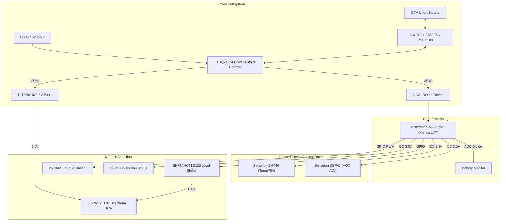

# ExitIQ — Edge AI Dynamic Emergency Evacuation Guidance Terminal

[](#)
[](#)
[](#)
[](LICENSE)

**ExitIQ** is an ESP32-S3-powered, decentralized Edge AI emergency evacuation guidance terminal designed to replace obsolete static signage with real-time, dynamic egress routing during smoke and fire emergencies.

---

## 1. Project Purpose & Problem Statement

Conventional fire evacuation systems rely on static exit signs and centralized alarms. In modern multi-story and industrial facilities, static signage presents critical failure modes:
1. **Blind Routing:** Static signs guide occupants toward fixed exits regardless of whether the path is blocked by thermal barriers or smoke.
2. **Panic Bottlenecks:** Occupants blindly funnel into primary stairwells, exacerbating lethal crushing and congestion.
3. **Single Point of Failure:** Centralized building management systems (BMS) often fail when fire severs cabling or data uplinks.

**The ExitIQ Solution:**  
ExitIQ operates as an autonomous, localized terminal. By monitoring real-time environmental vectors (ambient temperature and combustion off-gassing) on-device, each terminal independently evaluates hazard threat levels and actuates directional strobe arrays and an acoustic alarm to steer occupants along the safest verified egress route.

---

## 2. Key Engineering Features

- **Edge Controller:** Espressif ESP32-S3 (Dual-Core Xtensa LX7 @ 240 MHz, 8 MB Octal Flash, 8 MB Octal PSRAM) running localized inference and egress routing.
- **Environmental Sensing Bay:**
  - **Sensirion SHT40-AD1B:** High-accuracy ambient temperature ($\pm 0.2^\circ\text{C}$) and relative humidity monitoring.
  - **Sensirion SGP40-DIS-R4:** Metal-oxide (MOx) VOC Air Quality Index sensor detecting pyrolysis and volatile combustion by-products.
  - *Thermal Isolation:* FR4 slot cutout isolating the sensor bay from MCU heat dissipation.
- **Active Evacuation Signaling:**
  - **Directional Array:** 8× Worldsemi WS2812B addressable 5050 RGB LEDs with active logic-level conversion (TI SN74AHCT1G125).
  - **Status Interface:** 0.96" 128×64 OLED display (SSD1306 via I2C).
  - **Acoustic Warning:** CUI Devices CMT-8540S-SMT 85 dBA buzzer driven by an active 2N7002 N-channel MOSFET with 1N4148 flyback clamp.
- **Power Management & Fail-Safe Autonomy:**
  - **Dynamic Power-Path:** TI BQ24074 managing external 5V USB-C power and seamless battery handover without system brownout.
  - **Integrated Li-Ion Battery:** Single-cell 18650 / Li-Po cell with DW01A-G supervisor and FS8205A dual-FET protection.
  - **Synchronous Boost:** TI TPS61023 (90%+ efficiency) stepping battery voltage up to 5.0 V for the directional LED array.

---

## 3. System Architecture



---

## 4. Repository Structure

```
ExitIQ_GitHub_Release/
├── README.md                                  # Master project guide and verification summary
├── LICENSE                                    # MIT License
├── .gitignore                                 # KiCad, CAD, and OS exclusion rules
├── DESIGN_NOTES.md                            # Complete engineering architecture & power budget
├── hardware/
│   ├── schematics/
│   │   ├── ExitIQ.kicad_sch                   # Authoritative KiCad schematic
│   │   ├── ExitIQ.kicad_pro                   # KiCad project configuration
│   │   ├── ExitIQ.pdf                         # Full schematic release print
│   │   ├── ExitIQ.net                         # Netlist cross-probing file
│   │   └── fp-lib-table / sym-lib-table       # Relative library tables
│   ├── pcb/
│   │   ├── ExitIQ.kicad_pcb                   # Authoritative 100% routed 2-layer PCB
│   │   ├── ExitIQ.kicad_pro                   # PCB project settings
│   │   └── fp-lib-table                       # PCB footprint table
│   └── libraries/
│       ├── symbols/ExitIQ.kicad_sym           # Custom schematic symbols
│       └── footprints.pretty/                 # Custom footprints (e.g., SGP40 DFN-6)
├── mechanical/
│   ├── catia/
│   │   ├── ExitIQ_Enclosure_Assembly_ReleaseCandidate.CATProduct  # Authoritative RC assembly
│   │   ├── ExitIQ_Enclosure_Base.CATPart      # Base tub with 4 concentric standoffs
│   │   ├── ExitIQ_Enclosure_Lid_RC.CATPart    # Centered 55x8mm LED slot lid
│   │   ├── ExitIQ_PCB.CATPart                 # PCB substrate solid model
│   │   ├── [20 Component CATParts]            # Native solid bodies for all components
│   │   ├── build_catia_enclosure.vbs          # CATIA automation script
│   │   └── CATIA_ENCLOSURE_SPEC.md            # Mechanical specifications
│   ├── exports/
│   │   ├── ExitIQ_Enclosure_Assembly_ReleaseCandidate.step # Neutral 3D STEP assembly
│   │   ├── ExitIQ_Enclosure_Base.step         # Base STEP model
│   │   ├── ExitIQ_Enclosure_Lid_RC.step       # Lid STEP model
│   │   ├── ExitIQ.step                        # PCB 3D STEP model
│   │   └── ExitIQ_BoardOutline_Mounting.dxf   # 2D CAD profile with M3 hole centers
│   └── cad/
│       └── ExitIQ_BoardOutline_Mounting.dxf
├── fabrication/
│   ├── MANUFACTURING_SPEC.md                  # Complete PCB fabrication notes & stackup
│   ├── ExitIQ_Gerber_Drill_Package.zip        # Consolidated manufacturing ZIP
│   ├── assembly/
│   │   ├── ExitIQ_Assembly_BOM.csv            # Audited 41-line grouped BOM (70 total parts)
│   │   └── ExitIQ_all_pos.csv                 # Centroid pick-and-place positions
│   ├── drill/
│   │   ├── ExitIQ-PTH.drl / ExitIQ-NPTH.drl   # NC Excellon drill files
│   │   └── ExitIQ_drill_report.rpt            # Hole count and tooling breakdown
│   └── gerbers/                               # 9 RS-274X copper, mask, paste, silk & edge layers
├── presentation/
│   ├── ExitIQ_Stage2_Final_With_Vishwakarma_Logo.pptx # Authoritative 20-slide presentation
│   └── PPT-ExitIQ_System_Architecture_Updated.pptx    # Baseline competition deck
├── reports/
│   ├── FINAL_SUBMISSION_STATUS.md             # Master deliverables readiness audit
│   ├── FINAL_VALIDATION_REPORT.md             # Consolidated verification report
│   ├── ExitIQ_CATIA_Final_Verification.md     # Mechanical fit and clearance audit
│   ├── Final_Engineering_Review.md            # Peer engineering review
│   ├── erc/ExitIQ_ERC_FinalReview.rpt         # KiCad ERC report (0 errors, 0 warnings)
│   └── drc/ExitIQ_DRC_FinalReview.rpt         # KiCad DRC report (0 unconnected, 0 shorts)
└── images/
    ├── mechanical/                            # High-resolution CATIA renders (Assembly, Lid, Base)
    ├── pcb/                                   # KiCad 3D renders and 2D layout drawings
    └── evidence/                              # Genuine CATIA & KiCad feature tree evidence
```

---

## 5. Instructions for Opening & Inspecting the Project

### Mechanical CAD (MCAD)
- **Primary Tool:** Dassault Systèmes CATIA V5-6R2022 (or compatible release).
- **Opening the Assembly:**
  1. Launch CATIA and open [`mechanical/enclosure/ExitIQ_Enclosure_Assembly_ReleaseCandidate.CATProduct`](mechanical/enclosure/ExitIQ_Enclosure_Assembly_ReleaseCandidate.CATProduct).
  2. All part links resolve locally within the directory.
- **Universal 3D CAD (FreeCAD, Fusion 360, SolidWorks, STEP Viewer):**
  - Open the neutral ISO 10303 STEP file: [`mechanical/exports/ExitIQ_Enclosure_Assembly_ReleaseCandidate.step`](mechanical/exports/ExitIQ_Enclosure_Assembly_ReleaseCandidate.step).
  - Open the PCB 3D STEP file: [`mechanical/exports/ExitIQ.step`](mechanical/exports/ExitIQ.step).

### Electrical CAD (ECAD)
- **Primary Tool:** KiCad 10.0.6 (or KiCad 8/9+ with symbol migration).
- **Opening Schematic:**
  1. Open [`hardware/schematics/ExitIQ.kicad_pro`](hardware/schematics/ExitIQ.kicad_pro) or [`hardware/schematics/ExitIQ.kicad_sch`](hardware/schematics/ExitIQ.kicad_sch).
  2. Symbols load automatically via [`hardware/schematics/sym-lib-table`](hardware/schematics/sym-lib-table).
- **Opening PCB Layout:**
  1. Open [`hardware/pcb/ExitIQ.kicad_pro`](hardware/pcb/ExitIQ.kicad_pro) or [`hardware/pcb/ExitIQ.kicad_pcb`](hardware/pcb/ExitIQ.kicad_pcb).
  2. Custom footprints load via [`hardware/pcb/fp-lib-table`](hardware/pcb/fp-lib-table).

### Manufacturing Deliverables
- Inspect Gerbers in KiCad GerbView or online viewers (e.g., JLCPCB/PCBWay viewer) using [`fabrication/ExitIQ_Gerber_Drill_Package.zip`](fabrication/ExitIQ_Gerber_Drill_Package.zip).
- SMT assembly BOM: [`fabrication/assembly/ExitIQ_Assembly_BOM.csv`](fabrication/assembly/ExitIQ_Assembly_BOM.csv) (41 unique items, 70 components total).

---

## 6. Implementation Status & Verification Transparency

| Subsystem / Metric | Status | Evidence / Log File |
| :--- | :--- | :--- |
| **Schematic ERC** | `PASSED` (0 Errors, 0 Warnings) | [`reports/erc/ExitIQ_ERC_FinalReview.rpt`](reports/erc/ExitIQ_ERC_FinalReview.rpt) |
| **PCB Layout DRC** | `PASSED` (100% Routed, 0 Shorts) | [`reports/drc/ExitIQ_DRC_FinalReview.rpt`](reports/drc/ExitIQ_DRC_FinalReview.rpt) |
| **Unconnected Nets** | `0` (All 70 nets, 642 tracks connected) | [`reports/drc/ExitIQ_DRC_FinalReview.rpt`](reports/drc/ExitIQ_DRC_FinalReview.rpt) |
| **Ground Plane** | Continuous low-impedance B.Cu pour | [`fabrication/gerbers/ExitIQ-B_Cu.gbl`](fabrication/gerbers/ExitIQ-B_Cu.gbl) |
| **Mechanical Clearance** | 0 collisions, +2.40 mm top headroom | [`reports/ExitIQ_CATIA_Final_Verification.md`](reports/ExitIQ_CATIA_Final_Verification.md) |
| **LED Optical Window** | Centered $55 \times 8\text{ mm}$ slot over 8 LEDs | [`images/mechanical/ExitIQ_LED_RC_Alignment_Check.png`](images/mechanical/ExitIQ_LED_RC_Alignment_Check.png) |
| **Stage 2 Presentation** | 20 Slides complete with Vishwakarma Logo | [`presentation/ExitIQ_Stage2_Final_With_Vishwakarma_Logo.pptx`](presentation/ExitIQ_Stage2_Final_With_Vishwakarma_Logo.pptx) |

### Documented DFM CAM Waivers
In the spirit of complete engineering honesty:
1. **TPS61023 (U3) Fine-Pitch SOT-563 Pad Clearance ($0.150\text{ mm}$):** Standard package pin pitch ($0.50\text{ mm}$) requires standard fine-pitch CAM rule ($0.100\text{ mm}$ solder mask dam / gang mask).
2. **USB-C (J1) Unplated Alignment Peg Clearance ($0.1944\text{ mm}$):** Plastic mechanical locating posts have zero electrical connectivity and zero shorting risk.
3. **Sensor Demarcation:** The Sensirion SGP40 is a MOx-based VOC Air Quality Index sensor utilized for early pyrolysis gas detection. It is not an optical smoke detector certified under EN 54 or UL 268. Physical fire chamber calibration is scheduled for Stage 3 prototyping.

---

## 7. Competition & Team Credits

- **Competition:** Vishwakarma Awards 2026 (Maker Bhavan Foundation — MBF), Stage 2
- **Theme:** AI in Hardware & Manufacturing | Worker Safety & Hazard Prevention
- **Deliverables:** Stage 2 CAD, ECAD, Manufacturing Package, and Presentation Release

---

## 8. License

This project is licensed under the [MIT License](LICENSE).
